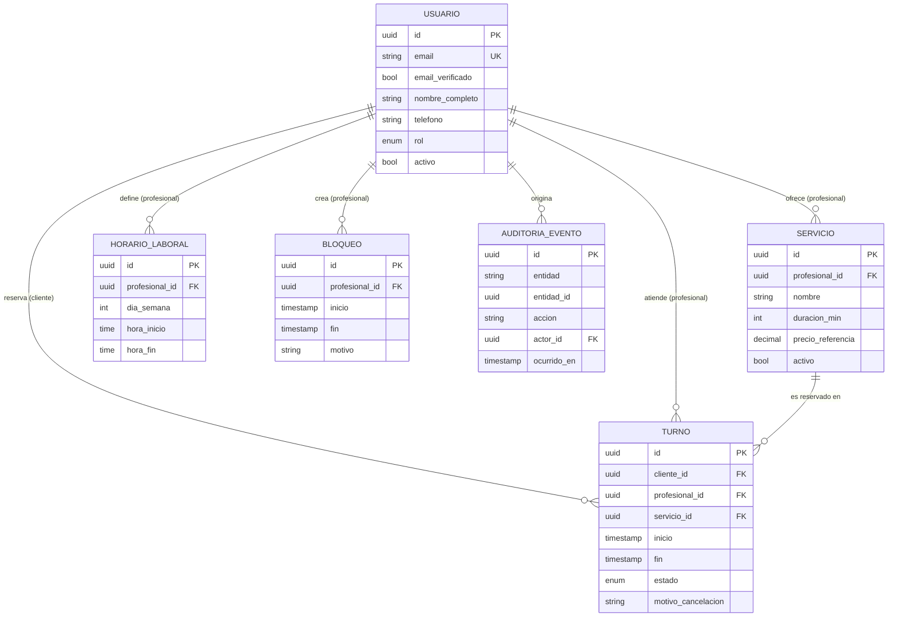

# spec.md — Sistema de Gestión de Turnos y Reservas de Servicios Profesionales

| Campo | Valor |
|---|---|
| Versión | 0.2.0 (MVP · Fase 2: arquitectura desacoplada) |
| Estado | Borrador para revisión |
| Metodología | Spec-Driven Development (SDD) |
| Fecha | 2026-10-27 |
| Versión anterior | 0.1.0 (2026-10-26). Cambios en la sección 12 |

> Este documento es el **contrato del sistema**. Todo código, test y decisión de diseño debe poder trazarse a una sección de este archivo. Si el código y la spec divergen, se corrige primero la spec y luego el código.

Palabras clave normativas: **DEBE** (obligatorio), **NO DEBE** (prohibido), **PUEDE** (opcional), según RFC 2119.

---

## 1. Alcance del MVP

### 1.1 Objetivo
Permitir que clientes reserven turnos con profesionales para servicios con duración definida, y que los profesionales/administradores gestionen su agenda sin conflictos.

### 1.2 Incluido (In scope)

| ID | Capacidad |
|---|---|
| F-01 | Registro e inicio de sesión de usuarios (email + contraseña). |
| F-02 | Catálogo público de servicios (nombre, descripción, duración, precio de referencia, profesional). |
| F-03 | Consulta de disponibilidad por servicio y fecha (slots libres calculados). |
| F-04 | Reserva de turno por parte del Cliente. |
| F-05 | Consulta de "Mis turnos" (próximos e históricos) del Cliente. |
| F-06 | Cancelación de turno propio por el Cliente (sujeta a RN-01). |
| F-07 | Gestión de servicios por el Profesional (alta, edición, baja lógica). |
| F-08 | Definición de horario laboral semanal recurrente del Profesional. |
| F-09 | Bloqueo de rangos horarios (vacaciones, almuerzo, imprevistos). |
| F-10 | Vista de agenda diaria/semanal con todos los turnos del Profesional. |
| F-11 | Cancelación de turno por el Profesional/Administrador (sin restricción de ventana, con motivo). |
| F-12 | Métricas básicas: turnos por período, tasa de cancelación, servicios más reservados, ocupación. |
| F-13 | Notificación por email de confirmación y cancelación. |

### 1.3 Excluido (Out of scope)

- Pagos en línea, señas, reembolsos y facturación.
- Reprogramación directa de turnos (el MVP resuelve con cancelar + reservar nuevo).
- Turnos recurrentes / paquetes de sesiones.
- Lista de espera.
- Múltiples sucursales o recursos físicos (salas, equipos).
- Integración con calendarios externos (Google/Outlook), recordatorios por SMS/WhatsApp.
- Login social / SSO, autenticación multifactor.
- Aplicación móvil nativa (el MVP es web responsive).
- Multi-idioma y multi-moneda (MVP: español, una moneda).
- Reseñas y calificaciones.
- Multi-tenancy (una sola organización por despliegue).

### 1.4 Supuestos

- Una única zona horaria de operación por despliegue (configurable); los instantes se almacenan en UTC.
- Un turno pertenece a **un** profesional y **un** servicio.
- Un profesional atiende un solo turno a la vez (capacidad = 1).
- El cliente final reserva con cuenta registrada (no hay reserva anónima).

---

## 2. Matriz de Roles y Permisos (RBAC)

### 2.1 Roles

| Rol | Descripción |
|---|---|
| `CLIENTE` | Usuario final que reserva servicios. |
| `PROFESIONAL` | Presta servicios; administra su propia agenda y servicios. |
| `ADMIN` | Gestiona toda la operación: todos los profesionales, servicios y usuarios. |
| Anónimo | Visitante sin sesión (solo lectura del catálogo). |

> Para el MVP, `PROFESIONAL` y `ADMIN` comparten el panel de gestión; `ADMIN` amplía el alcance a **todos** los profesionales.

### 2.2 Matriz de permisos

Leyenda: ✅ permitido · ❌ prohibido · 🔒 solo sobre recursos propios

| Recurso / Acción | Anónimo | CLIENTE | PROFESIONAL | ADMIN |
|---|:-:|:-:|:-:|:-:|
| Ver catálogo de servicios | ✅ | ✅ | ✅ | ✅ |
| Ver disponibilidad (slots libres) | ✅ | ✅ | ✅ | ✅ |
| Registrarse / iniciar sesión | ✅ | — | — | — |
| Crear turno | ❌ | ✅ (para sí) | ❌ | ✅ (en nombre de un cliente) |
| Ver turno | ❌ | 🔒 | 🔒 (de su agenda) | ✅ |
| Cancelar turno | ❌ | 🔒 (sujeto a RN-01) | 🔒 (sin ventana mínima) | ✅ (sin ventana mínima) |
| Editar datos de contacto propios | ❌ | 🔒 | 🔒 | ✅ |
| Crear/editar/desactivar servicios | ❌ | ❌ | 🔒 | ✅ |
| Definir horario laboral | ❌ | ❌ | 🔒 | ✅ |
| Bloquear / desbloquear rangos horarios | ❌ | ❌ | 🔒 | ✅ |
| Ver agenda completa | ❌ | ❌ | 🔒 | ✅ |
| Ver métricas | ❌ | ❌ | 🔒 (propias) | ✅ (globales) |
| Gestionar usuarios y roles | ❌ | ❌ | ❌ | ✅ |

### 2.3 Reglas de autorización

- **RBAC-01**: Toda operación DEBE verificar rol **y** propiedad del recurso en el backend; la UI nunca es la barrera de seguridad.
- **RBAC-02**: Un acceso a un recurso ajeno DEBE responder `404` (no `403`) para no revelar su existencia a un `CLIENTE`.
- **RBAC-03**: El rol se asigna únicamente por un `ADMIN`; el auto-registro siempre crea `CLIENTE`.
- **RBAC-04**: Un `CLIENTE` NO DEBE poder ver datos de contacto de otros clientes. El `PROFESIONAL` solo ve los datos de contacto de clientes con turnos en su agenda.

---

## 3. Reglas Invariantes del Negocio

Las siguientes reglas son **no negociables**: se validan en el backend, y la base de datos DEBE reforzarlas con restricciones cuando sea técnicamente posible. Ninguna regla puede ser omitida por la UI ni por un rol (salvo excepción explícita indicada).

### Identificadores de invariantes

Desde la v0.2.0 las tres reglas que gobiernan la Fase 2 también se citan como `INV-xx`. Los identificadores `RN-xx` **no cambian** y siguen siendo válidos en todo el documento.

| Invariante | Regla | Estado en v0.2.0 |
|---|---|---|
| **INV-01** | Ventana mínima de cancelación (≥ 2 h) = [RN-01](#rn-01--ventana-mínima-de-cancelación) | **Inmutable**, texto sin cambios |
| **INV-02** | Prohibición de solapamiento = [RN-02](#rn-02--prohibición-de-doble-reserva-y-solapamiento) | **Inmutable**, texto sin cambios |
| **INV-03** | Persistencia real = [INV-03](#inv-03--persistencia-real) | **Nueva** |

### RN-01 — Ventana mínima de cancelación

- Un `CLIENTE` NO DEBE cancelar un turno si faltan **menos de 2 horas** para su `inicio`.
- Valor configurable (`CANCELLATION_WINDOW_HOURS`, default `2`); el cálculo usa `inicio - ahora(UTC)`.
- Un turno ya iniciado, finalizado o cancelado NO DEBE ser cancelable.
- **Excepción**: `PROFESIONAL`/`ADMIN` PUEDEN cancelar fuera de ventana, con motivo obligatorio, y el cliente DEBE ser notificado.
- Respuesta ante violación: error `CANCELLATION_WINDOW_EXPIRED` (HTTP 409).

### RN-02 — Prohibición de doble reserva y solapamiento

- Para un mismo profesional, dos turnos en estado activo (`CONFIRMADO`) NO DEBEN solaparse en el tiempo.
- Se define el solapamiento sobre intervalos semiabiertos `[inicio, fin)`: dos turnos A y B se solapan si `A.inicio < B.fin` **y** `B.inicio < A.fin`. Turnos contiguos (`A.fin == B.inicio`) son válidos.
- Un turno NO DEBE solaparse con un bloqueo horario (RN-05) ni quedar fuera del horario laboral del profesional.
- Un mismo cliente NO DEBE tener dos turnos activos solapados (aunque sean con distintos profesionales).
- **Garantía ante concurrencia**: la verificación DEBE ser atómica. Se exige restricción a nivel de base de datos (p. ej. `EXCLUDE USING gist` sobre rango temporal por profesional en PostgreSQL, o transacción con bloqueo + índice único equivalente). Una validación solo en la aplicación NO es suficiente.
- Los turnos `CANCELADO` NO participan del control de solapamiento (el slot se libera).
- Respuesta ante violación: error `SLOT_UNAVAILABLE` (HTTP 409).

### RN-03 — Validación obligatoria de datos de contacto

- Para crear un turno, el `CLIENTE` DEBE tener un perfil con: **nombre completo** (2–100 caracteres), **email válido** (RFC 5322 simplificado, único por usuario) y **teléfono** válido en formato E.164 o equivalente local normalizado.
- El email DEBE estar **verificado** (enlace de confirmación) antes de la primera reserva.
- La reserva NO DEBE persistirse si algún dato de contacto falta o es inválido (error `INVALID_CONTACT`, HTTP 422).
- Los datos se normalizan (trim, minúsculas en email, teléfono a E.164) antes de validar y guardar.

### RN-04 — Integridad temporal del turno

- `inicio` DEBE ser estrictamente futuro respecto a `ahora` al momento de crear el turno, con una **antelación mínima** configurable (default: 1 hora).
- `fin = inicio + duración del servicio`; el cliente NO DEBE enviar `fin` (se calcula en servidor).
- El `inicio` DEBE estar alineado a la grilla de slots del profesional (default: 15 min).
- Existe un **horizonte máximo de reserva** (default: 60 días).
- Todos los instantes se almacenan en UTC y se muestran en la zona horaria de operación.

### RN-05 — Bloqueos horarios

- Un bloqueo es un rango `[inicio, fin)` del profesional en el que no se pueden crear turnos.
- Crear un bloqueo sobre un rango con turnos activos DEBE ser rechazado con listado de conflictos, **salvo** que el profesional confirme cancelarlos (lo cual aplica la excepción de RN-01 y notifica a los clientes).

### RN-06 — Ciclo de vida del turno

Estados: `CONFIRMADO` → `CANCELADO` | `COMPLETADO` | `AUSENTE`.

| Transición | Quién | Condición |
|---|---|---|
| (nuevo) → `CONFIRMADO` | Cliente / Admin | Cumple RN-02, RN-03, RN-04 |
| `CONFIRMADO` → `CANCELADO` | Cliente | Cumple RN-01 |
| `CONFIRMADO` → `CANCELADO` | Profesional / Admin | Motivo obligatorio |
| `CONFIRMADO` → `COMPLETADO` | Profesional / Admin | `ahora ≥ inicio` |
| `CONFIRMADO` → `AUSENTE` | Profesional / Admin | `ahora ≥ fin` |

- Los estados `CANCELADO`, `COMPLETADO` y `AUSENTE` son **terminales**; ninguna transición sale de ellos.
- Un turno NO DEBE eliminarse físicamente; el historial es inmutable (solo cambia de estado).

### RN-07 — Integridad de catálogo

- Un servicio con turnos futuros activos NO DEBE eliminarse; solo desactivarse (baja lógica), lo cual impide nuevas reservas sin afectar las existentes.
- La duración de un servicio DEBE ser múltiplo de la grilla de slots y estar entre 15 min y 8 h.
- Modificar la duración de un servicio NO altera turnos ya confirmados.

### RN-08 — Trazabilidad

- Toda creación, cancelación y cambio de estado DEBE registrar: actor, rol, instante UTC y motivo (si aplica) en un log de auditoría inmutable.

### INV-03 — Persistencia real

- Todo turno DEBE persistir de forma **atómica** en una base de datos relacional. La creación y la cancelación de un turno son transacciones de todo o nada: ante un fallo no queda ningún cambio parcial.
- Un turno confirmado o cancelado DEBE **sobrevivir al reinicio** del sistema (backend y base de datos) sin pérdida de datos.
- El estado de los turnos NO DEBE residir únicamente en memoria volátil (variables de proceso ni estado del navegador). La base de datos es la única fuente de verdad.
- Toda operación que cambie un turno DEBE confirmarse (`COMMIT`) antes de responder éxito al cliente HTTP. Si la transacción falla, el sistema responde error y no persiste nada.
- La atomicidad aplica también a la verificación de INV-02: comprobar el solapamiento y escribir el turno ocurren dentro de la misma transacción.
- El esquema relacional DEBE limitarse a las entidades y atributos de la sección 4. No se agregan tablas ni campos que no figuren allí sin antes versionar esta spec.
- Respuesta ante fallo de persistencia: error `PERSISTENCE_ERROR` (HTTP 500). La respuesta no expone detalles internos de la base de datos.

---

## 4. Modelo de Datos Conceptual

### 4.1 Entidades principales

#### Usuario
| Atributo | Tipo | Restricciones |
|---|---|---|
| `id` | UUID | PK |
| `email` | texto | Único, obligatorio, normalizado |
| `email_verificado` | booleano | Default `false` |
| `password_hash` | texto | Obligatorio (nunca en claro) |
| `nombre_completo` | texto | Obligatorio, 2–100 |
| `telefono` | texto | Obligatorio, E.164 |
| `rol` | enum | `CLIENTE` \| `PROFESIONAL` \| `ADMIN` |
| `activo` | booleano | Default `true` |
| `creado_en` | timestamp UTC | |

#### Servicio
| Atributo | Tipo | Restricciones |
|---|---|---|
| `id` | UUID | PK |
| `profesional_id` | UUID | FK → Usuario (rol `PROFESIONAL`) |
| `nombre` | texto | Obligatorio |
| `descripcion` | texto | Opcional |
| `duracion_min` | entero | 15–480, múltiplo de la grilla |
| `precio_referencia` | decimal | ≥ 0, informativo |
| `activo` | booleano | Baja lógica (RN-07) |

#### Turno
| Atributo | Tipo | Restricciones |
|---|---|---|
| `id` | UUID | PK |
| `cliente_id` | UUID | FK → Usuario (rol `CLIENTE`) |
| `profesional_id` | UUID | FK → Usuario (rol `PROFESIONAL`) |
| `servicio_id` | UUID | FK → Servicio |
| `inicio` | timestamp UTC | Futuro al crear (RN-04) |
| `fin` | timestamp UTC | Calculado: `inicio + duración` |
| `estado` | enum | Ver RN-06 |
| `motivo_cancelacion` | texto | Obligatorio si lo cancela Profesional/Admin |
| `cancelado_por_id` | UUID | FK → Usuario, nullable |
| `creado_en` / `actualizado_en` | timestamp UTC | |

*Restricción clave*: exclusión de rangos `[inicio, fin)` por `profesional_id` cuando `estado = CONFIRMADO` (RN-02).

#### Entidades de soporte

| Entidad | Atributos clave | Propósito |
|---|---|---|
| **HorarioLaboral** | `id`, `profesional_id`, `dia_semana` (0–6), `hora_inicio`, `hora_fin` | Disponibilidad semanal recurrente (F-08). |
| **Bloqueo** | `id`, `profesional_id`, `inicio`, `fin`, `motivo` | Rangos no reservables (F-09, RN-05). |
| **AuditoriaEvento** | `id`, `entidad`, `entidad_id`, `accion`, `actor_id`, `rol`, `ocurrido_en`, `detalle` | Trazabilidad inmutable (RN-08). |

### 4.2 Relaciones y cardinalidad

```
Usuario (PROFESIONAL) 1 ──── N Servicio
Usuario (PROFESIONAL) 1 ──── N HorarioLaboral
Usuario (PROFESIONAL) 1 ──── N Bloqueo
Usuario (PROFESIONAL) 1 ──── N Turno      (como profesional atendiendo)
Usuario (CLIENTE)     1 ──── N Turno      (como cliente reservando)
Servicio              1 ──── N Turno
Usuario               1 ──── N AuditoriaEvento (actor)
```



> **v0.2.0:** el modelo de datos de esta sección **no cambia**. Es el único origen permitido de entidades y campos para la base de datos y para la API de la sección 11.

### 4.3 Invariantes de integridad referencial

- `Turno.profesional_id` DEBE coincidir con `Servicio.profesional_id` del `servicio_id` asociado.
- `Turno.cliente_id` y `Turno.profesional_id` DEBEN ser usuarios distintos.
- Ninguna FK usa borrado en cascada sobre `Turno`; el historial se preserva (RN-06, RN-07).

---

## 5. Métricas del MVP (F-12)

| Métrica | Definición |
|---|---|
| Turnos por período | Conteo de turnos `CONFIRMADO`/`COMPLETADO` agrupados por día/semana/mes. |
| Tasa de cancelación | `CANCELADO / total creados` en el período, con desglose por quién canceló. |
| Tasa de ausentismo | `AUSENTE / (COMPLETADO + AUSENTE)`. |
| Ocupación | Minutos reservados / minutos disponibles (horario laboral − bloqueos). |
| Top servicios | Ranking de servicios por cantidad de turnos. |

Alcance: el `PROFESIONAL` ve solo las suyas; el `ADMIN` ve las globales y por profesional.

---

## 6. Requisitos No Funcionales (mínimos del MVP)

- **Seguridad**: contraseñas con hash adaptativo (argon2/bcrypt), HTTPS obligatorio, sesiones con expiración, protección CSRF/XSS, rate limiting en login y reserva.
- **Consistencia**: la creación de turno es transaccional y atómica (RN-02).
- **Rendimiento**: consulta de disponibilidad < 500 ms p95 con hasta 50 profesionales.
- **Privacidad**: datos de contacto accesibles solo según RBAC-04; cumplimiento de la normativa local de protección de datos personales.
- **Disponibilidad**: objetivo 99,5 % mensual (sin HA en MVP).
- **Accesibilidad**: WCAG 2.1 AA en flujos de reserva.

---

## 7. Catálogo de Errores de Dominio

| Código | HTTP | Origen |
|---|---|---|
| `SLOT_UNAVAILABLE` | 409 | RN-02, RN-05 |
| `CANCELLATION_WINDOW_EXPIRED` | 409 | RN-01 |
| `INVALID_CONTACT` | 422 | RN-03 |
| `EMAIL_NOT_VERIFIED` | 403 | RN-03 |
| `INVALID_TIME_RANGE` | 422 | RN-04 |
| `INVALID_STATE_TRANSITION` | 409 | RN-06 |
| `SERVICE_HAS_ACTIVE_BOOKINGS` | 409 | RN-07 |
| `FORBIDDEN` / `NOT_FOUND` | 403 / 404 | RBAC-01, RBAC-02 |
| `PERSISTENCE_ERROR` | 500 | INV-03 |

---

## 8. Criterios de Aceptación (muestra Given/When/Then)

1. **Doble reserva**: *Dado* un turno `CONFIRMADO` de 10:00–10:30 con el profesional P, *cuando* otro cliente reserva 10:15–10:45 con P, *entonces* el sistema responde `SLOT_UNAVAILABLE` y no persiste nada.
2. **Concurrencia**: *Dado* dos solicitudes simultáneas por el mismo slot, *entonces* exactamente una se confirma y la otra recibe `SLOT_UNAVAILABLE`.
3. **Contigüidad**: *Dado* un turno 10:00–10:30, *cuando* se reserva 10:30–11:00, *entonces* se confirma.
4. **Cancelación en ventana**: *Dado* un turno que inicia en 3 h, *cuando* el cliente cancela, *entonces* pasa a `CANCELADO` y el slot queda libre.
5. **Cancelación fuera de ventana**: *Dado* un turno que inicia en 1 h 59 min, *cuando* el cliente cancela, *entonces* `CANCELLATION_WINDOW_EXPIRED`.
6. **Contacto inválido**: *Dado* un cliente sin teléfono válido, *cuando* intenta reservar, *entonces* `INVALID_CONTACT`.
7. **Aislamiento**: *Dado* el turno T del cliente A, *cuando* el cliente B consulta T, *entonces* recibe `404`.
8. **Bloqueo con conflicto**: *Dado* un turno confirmado dentro de un rango, *cuando* el profesional intenta bloquearlo sin confirmar, *entonces* el sistema lista los conflictos y no crea el bloqueo.
9. **Supervivencia al reinicio (INV-03)**: *Dado* un turno creado con `POST /api/turnos` y respondido `201`, *cuando* se reinicia el backend, *entonces* `GET /api/turnos` lo devuelve con los mismos datos.
10. **Atomicidad (INV-03)**: *Dado* un fallo durante la escritura de un turno, *entonces* el sistema responde error y `GET /api/turnos` no muestra ningún turno parcial.
11. **Persistencia de la cancelación (INV-03)**: *Dado* un turno cancelado con `POST /api/turnos/{id}/cancelar`, *cuando* se reinicia el backend, *entonces* el turno sigue en estado `CANCELADO` y el slot sigue libre.

---

## 9. Decisiones Abiertas (a resolver antes de implementar)

| # | Pregunta | Propuesta por defecto |
|---|---|---|
| D-01 | ¿Un cliente puede tener límite de turnos activos simultáneos? | Sin límite en MVP |
| D-02 | ¿Los Profesionales pueden ser dados de alta por auto-registro? | No, solo vía `ADMIN` |
| D-03 | ¿Política de cancelaciones reiteradas / penalización? | Fuera del MVP |
| D-04 | Stack tecnológico y motor de BD (requiere soporte de exclusión de rangos) | ~~PostgreSQL~~ **Resuelta en v0.2.0:** Python + FastAPI y SQLite (`turnos.db`). Ver [plan.md](plan.md) |
| D-05 | ¿Confirmación automática o aprobación manual del profesional? | Automática |
| D-06 | ¿Cómo se identifica al actor en la API de la Fase 2, si el login (F-01) no está implementado? | El actor se declara con campos existentes de `Turno` (`cliente_id`, `cancelado_por_id`) y el backend resuelve su `rol` desde `Usuario`. La autenticación real queda fuera de la Fase 2 |
| D-07 | ¿Qué endpoints expone la Fase 2 además de los 3 de la sección 11? | Ninguno. Servicios, bloqueos y métricas siguen fuera de la API en esta fase |

---

## 10. Trazabilidad (Spec → Código → Test)

| Spec | Código (a completar) | Test (a completar) |
|---|---|---|
| RN-01 / INV-01 | `POST /api/turnos/{id}/cancelar` | Criterios 4, 5 |
| RN-02 / INV-02 | `POST /api/turnos` | Criterios 1, 2, 3 |
| RN-03 | `POST /api/turnos` | Criterio 6 |
| INV-03 | `GET /api/turnos`, `POST /api/turnos`, `POST /api/turnos/{id}/cancelar` | Criterios 9, 10, 11 |
| RBAC-02 | `GET /api/turnos`, `POST /api/turnos/{id}/cancelar` | Criterio 7 |
| RN-05 | — (fuera de la API en la Fase 2) | Criterio 8 |

---

## 11. Contrato de API REST (Fase 2)

Este contrato gobierna el Backend. Las únicas entidades y campos permitidos son los de la sección 4.

### 11.1 Convenciones

- Base: `http://localhost:8000`. Prefijo `/api`. Formato: JSON (`application/json`, UTF-8).
- Los nombres de campo del JSON son **idénticos** a los atributos de `Turno` de la sección 4.1.
- Los instantes (`inicio`, `fin`, `creado_en`, `actualizado_en`) viajan en **ISO 8601 UTC** (por ejemplo `2026-11-03T13:00:00Z`).
- El backend DEBE habilitar CORS para que el Frontend pueda consumir la API desde otro origen.
- Los errores usan el catálogo de la sección 7 con este cuerpo:

```json
{ "error": { "codigo": "SLOT_UNAVAILABLE", "mensaje": "El horario ya no está disponible." } }
```

- Identificación del actor: ver D-06. `rol` nunca viaja en la petición; el backend lo obtiene de `Usuario.rol`.

### 11.2 Recurso `Turno` (representación)

| Campo | Tipo JSON | Origen |
|---|---|---|
| `id` | string (UUID) | `Turno.id` |
| `cliente_id` | string (UUID) | `Turno.cliente_id` |
| `profesional_id` | string (UUID) | `Turno.profesional_id` |
| `servicio_id` | string (UUID) | `Turno.servicio_id` |
| `inicio` | string (ISO 8601 UTC) | `Turno.inicio` |
| `fin` | string (ISO 8601 UTC) | `Turno.fin` |
| `estado` | string | `Turno.estado`: `CONFIRMADO` \| `CANCELADO` \| `COMPLETADO` \| `AUSENTE` |
| `motivo_cancelacion` | string \| null | `Turno.motivo_cancelacion` |
| `cancelado_por_id` | string (UUID) \| null | `Turno.cancelado_por_id` |
| `creado_en` | string (ISO 8601 UTC) | `Turno.creado_en` |
| `actualizado_en` | string (ISO 8601 UTC) | `Turno.actualizado_en` |

### 11.3 `GET /api/turnos` — listar turnos

| Aspecto | Definición |
|---|---|
| Propósito | Devolver los turnos persistidos (INV-03). |
| Parámetros de consulta (opcionales) | `cliente_id`, `profesional_id`, `estado`. Todos son atributos de `Turno`; se combinan con AND. |
| Respuesta `200` | Arreglo JSON de `Turno`, ordenado por `inicio` ascendente. Vacío (`[]`) si no hay resultados. |
| Errores | `422` si `estado` está fuera del enum de RN-06. `500 PERSISTENCE_ERROR`. |
| Autorización | RBAC-02 y RBAC-04: un `CLIENTE` solo recibe sus propios turnos (se filtra por su `cliente_id`). |

### 11.4 `POST /api/turnos` — crear reserva

| Aspecto | Definición |
|---|---|
| Propósito | Crear un turno `CONFIRMADO` (RN-06) aplicando INV-02, RN-03 y RN-04. |
| Cuerpo | `cliente_id` (obligatorio), `servicio_id` (obligatorio), `inicio` (obligatorio). |
| Prohibido en el cuerpo | `fin` (RN-04: lo calcula el servidor), `profesional_id` (se toma de `Servicio.profesional_id`, sección 4.3), `estado`, `id` y marcas de tiempo. |
| Respuesta `201` | El `Turno` creado, con `estado = CONFIRMADO` y `fin = inicio + duracion_min`. Cabecera `Location: /api/turnos/{id}`. |
| Atomicidad | La verificación de INV-02 y la inserción ocurren en **una sola transacción** (INV-03). |

Errores:

| Código | HTTP | Condición |
|---|---|---|
| `SLOT_UNAVAILABLE` | 409 | Solapamiento con otro turno `CONFIRMADO`, con un bloqueo, o fuera del horario laboral (RN-02). |
| `INVALID_CONTACT` | 422 | Datos de contacto del cliente ausentes o inválidos (RN-03). |
| `EMAIL_NOT_VERIFIED` | 403 | `Usuario.email_verificado = false` (RN-03). |
| `INVALID_TIME_RANGE` | 422 | `inicio` no futuro, sin antelación mínima, fuera de la grilla o fuera del horizonte (RN-04). |
| `NOT_FOUND` | 404 | `cliente_id` o `servicio_id` inexistente, o servicio inactivo. |
| `PERSISTENCE_ERROR` | 500 | Falla la transacción (INV-03). No queda ningún cambio parcial. |

### 11.5 `POST /api/turnos/{id}/cancelar` — cancelar reserva

| Aspecto | Definición |
|---|---|
| Propósito | Pasar un turno de `CONFIRMADO` a `CANCELADO` (RN-06) aplicando INV-01. |
| Parámetro de ruta | `id`: `Turno.id`. |
| Cuerpo | `cancelado_por_id` (obligatorio). `motivo_cancelacion` (obligatorio si el actor es `PROFESIONAL` o `ADMIN`; opcional si es `CLIENTE`). |
| Respuesta `200` | El `Turno` actualizado: `estado = CANCELADO`, con `cancelado_por_id`, `motivo_cancelacion` y `actualizado_en`. El slot queda libre (RN-02). |
| Atomicidad | La lectura del estado, la verificación de INV-01 y la actualización ocurren en **una sola transacción** (INV-03). |

Errores:

| Código | HTTP | Condición |
|---|---|---|
| `CANCELLATION_WINDOW_EXPIRED` | 409 | Actor `CLIENTE` y faltan menos de `CANCELLATION_WINDOW_HOURS` (default 2) para `inicio`, o el turno ya inició (INV-01). |
| `INVALID_STATE_TRANSITION` | 409 | El turno no está `CONFIRMADO` (RN-06). |
| `INVALID_CONTACT` | 422 | Actor `PROFESIONAL`/`ADMIN` sin `motivo_cancelacion` (RN-01, excepción). |
| `NOT_FOUND` | 404 | El turno no existe, o es ajeno al actor `CLIENTE` (RBAC-02). |
| `FORBIDDEN` | 403 | El actor no tiene rol con permiso de cancelar este turno (matriz 2.2). |
| `PERSISTENCE_ERROR` | 500 | Falla la transacción (INV-03). |

El cuerpo de ejemplo para un `CLIENTE` es `{ "cancelado_por_id": "<UUID del cliente>" }`.

### 11.6 Fuera del contrato de la Fase 2

No se definen en esta versión: endpoints de usuarios, servicios, horarios laborales, bloqueos, métricas, auditoría ni autenticación (D-07). Los datos de `Usuario`, `Servicio`, `HorarioLaboral` y `Bloqueo` necesarios para validar las reglas se cargan en la base de datos de forma inicial (ver [plan.md](plan.md)).

---

## 12. Historial de versiones

| Versión | Fecha | Cambios |
|---|---|---|
| 0.1.0 | 2026-10-26 | Spec inicial del MVP: alcance, RBAC, RN-01 a RN-08, modelo de datos, métricas, errores y criterios. |
| 0.2.0 | 2026-10-27 | Se agregan los alias `INV-01` (= RN-01) e `INV-02` (= RN-02), sin tocar su texto. Se incorpora **INV-03 (Persistencia real)**. Se agrega el error `PERSISTENCE_ERROR`. Se resuelve D-04 (FastAPI + SQLite) y se abren D-06 y D-07. Se agrega la sección 11 (contrato REST) y los criterios 9 a 11. El modelo de datos de la sección 4 no cambia. |
